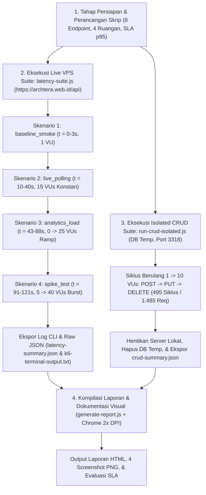
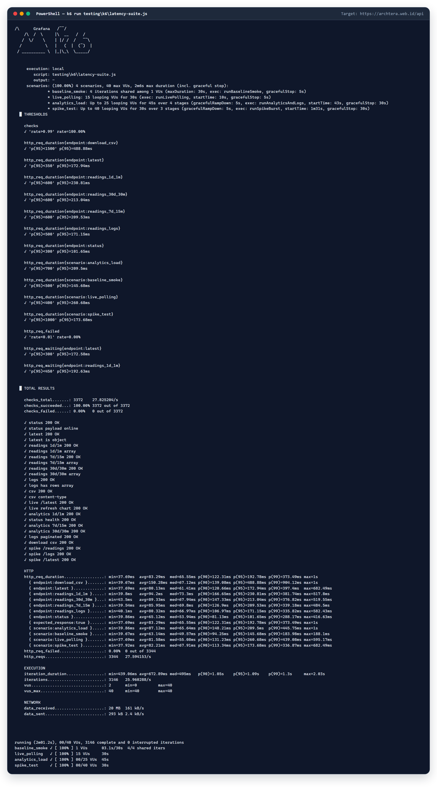
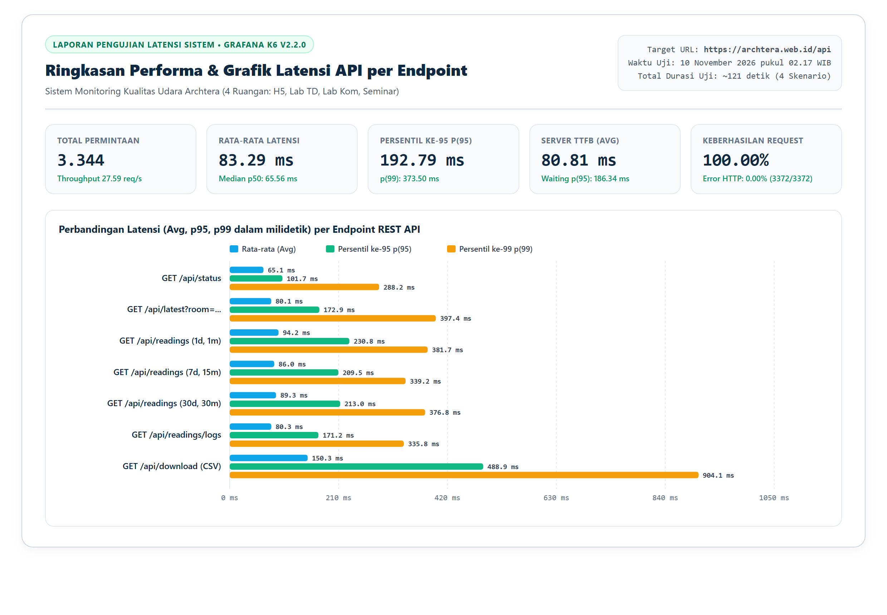
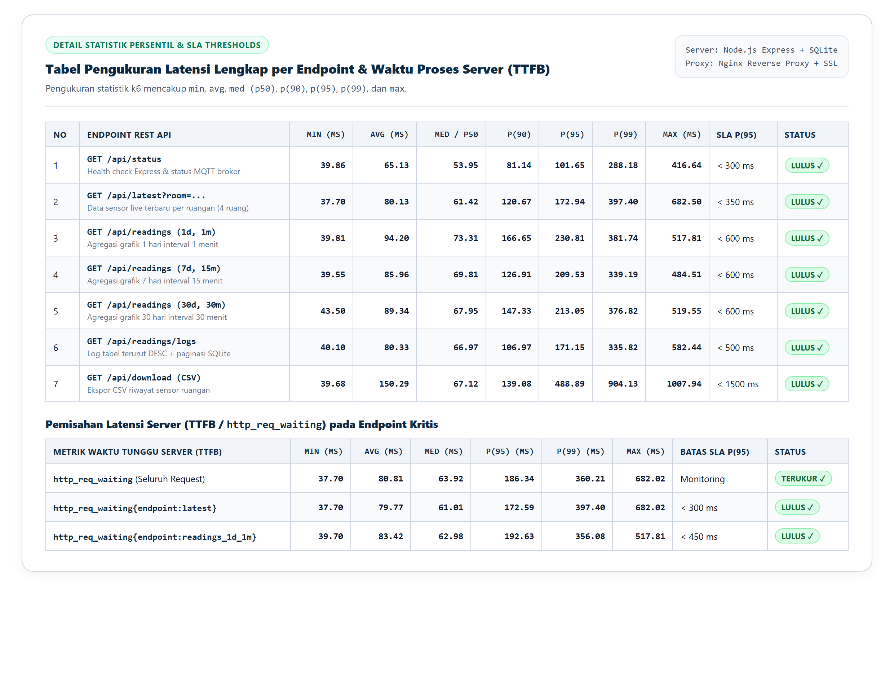
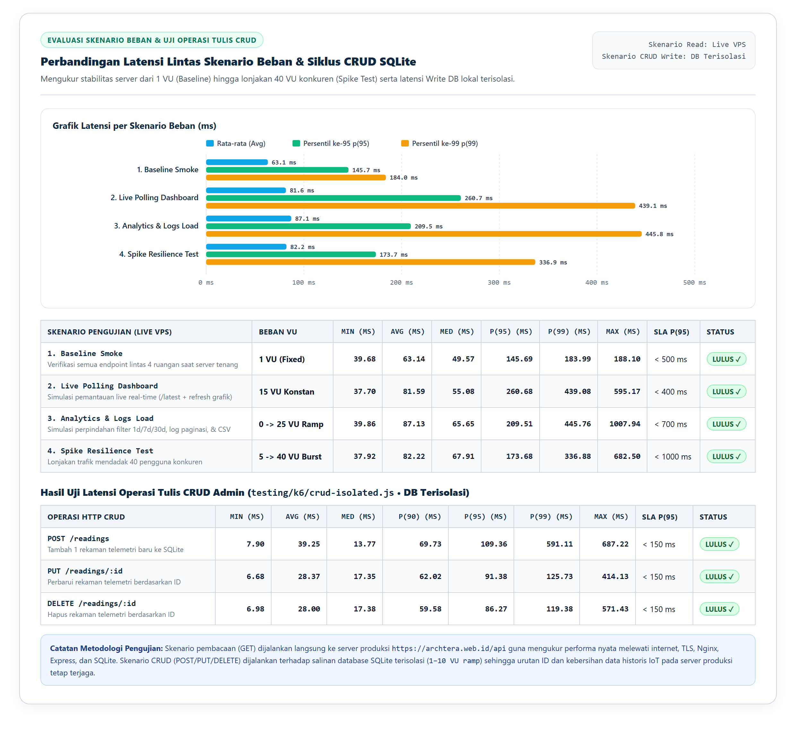

# Pengujian Latensi dan Kinerja REST API Sistem Archtera Menggunakan Grafana k6

Pengujian non-fungsional berupa pengujian kinerja dan latensi (*performance and latency testing*) dilakukan untuk mengevaluasi kecepatan respons, kestabilan pemrosesan konkuren, serta keandalan layanan *backend* pada sistem **Archtera — Air Safe Area** di bawah berbagai kondisi beban akses pengguna. Berbeda dengan pengujian fungsional (*black-box testing*) yang berfokus pada kebenaran keluaran logika setiap *endpoint*, pengujian latensi ini berfokus pada perilaku sistem terhadap waktu tanggap (*response time*), beban serentak (*concurrency*), dan waktu pemrosesan sisi *server* (*Time to First Byte / TTFB*). Seluruh rangkaian pengujian dilaksanakan pada tanggal 10 November 2026 menggunakan perkakas *load testing* sumber terbuka **Grafana `k6 v2.2.0`** dengan target utama *server* produksi pada domain `https://archtera.web.id/api` serta pengujian operasi tulis terisolasi terhadap *backend* lokal `http://127.0.0.1:3318`.

---

## 4.1 Tujuan dan Ruang Lingkup Pengujian

Pengujian kinerja sistem bertujuan memperoleh ukuran kuantitatif yang objektif terkait kesiapan layanan REST API Archtera saat diakses secara simultan oleh banyak pengguna maupun ketika memproses kueri historis sensor dari empat ruangan yang dipantau, yaitu Ruang H5 (`h5`), Laboratorium Teknik Digital (`lab_td`), Laboratorium Komputer (`lab_kom`), dan Ruang Seminar (`seminar`). Adapun sasaran spesifik yang ingin dibuktikan melalui pengujian ini meliputi:

1. Mengukur latensi *end-to-end* secara nyata melewati jaringan internet publik, enkripsi HTTPS/TLS, *reverse proxy* Nginx, aplikasi Node.js Express (`backend/bridge.js`), hingga kueri basis data SQLite (`better-sqlite3`).
2. Memverifikasi efektivitas indeks komposit basis data `idx_readings_room_time_id` dalam menjaga kecepatan kueri agregasi grafik berbasis interval waktu (per 1 menit, per 15 menit, dan per 30 menit) serta kueri paginasi log riwayat.
3. Mengukur ketahanan *server* saat menghadapi lonjakan trafik mendadak (*spike test*) hingga 40 pengguna virtual konkuren (*Virtual Users*) tanpa menimbulkan kegagalan respons HTTP (`0,00%` error).
4. Mengukur latensi operasi tulis *Create, Read, Update, Delete* (CRUD) secara terisolasi sehingga kelancaran manajemen data pada halaman `/admin` dapat terukur tanpa mencemari basis data produksi maupun menggeser urutan *primary key ID* rekaman IoT yang sedang berjalan.

Untuk menjamin kelengkapan cakupan sistem, pengujian diarahkan ke seluruh **8 endpoint REST API** yang tersedia pada *backend* Archtera. Pemetaan masing-masing *endpoint* beserta peran fungsional dan kelompok pengujiannya disajikan pada **Tabel 4.1** berikut.

**Tabel 4.1 Cakupan Endpoint REST API Sistem Archtera pada Pengujian Latensi**

| No | Metode & Path Endpoint | Fungsi Sistem | Target Lingkungan Uji | Skenario Pengujian Terkait |
| :---: | :--- | :--- | :--- | :--- |
| 1 | `GET /api/status` | Pemeriksaan kesiapan *server* Express dan status koneksi *broker* MQTT EMQX | Live VPS (`archtera.web.id`) | `baseline_smoke`, `analytics_load` |
| 2 | `GET /api/latest` | Pengambilan 1 data telemetri terbaru per ruangan untuk kartu metrik *real-time* | Live VPS (`archtera.web.id`) | `baseline_smoke`, `live_polling`, `spike_test` |
| 3 | `GET /api/readings` | Pengambilan deret waktu teragregasi (`1d/1m`, `7d/15m`, `30d/30m`) untuk grafik dashboard | Live VPS (`archtera.web.id`) | `baseline_smoke`, `live_polling`, `analytics_load`, `spike_test` |
| 4 | `GET /api/readings/logs` | Pengambilan tabel log riwayat terurut `DESC` dengan paginasi sisi *server* | Live VPS (`archtera.web.id`) | `baseline_smoke`, `analytics_load`, `spike_test` |
| 5 | `GET /api/download` | Ekspor data historis sensor dari SQLite menjadi berkas berformat CSV | Live VPS (`archtera.web.id`) | `baseline_smoke`, `analytics_load` |
| 6 | `POST /readings` | Penambahan 1 rekaman telemetri baru melalui jalur HTTP JSON (*Create*) | Lokal Terisolasi (`127.0.0.1:3318`) | `crud_lifecycle` |
| 7 | `PUT /readings/:id` | Pembaruan data rekaman telemetri berdasarkan `id` (*Update*) | Lokal Terisolasi (`127.0.0.1:3318`) | `crud_lifecycle` |
| 8 | `DELETE /readings/:id` | Penghapusan rekaman telemetri berdasarkan `id` (*Delete*) | Lokal Terisolasi (`127.0.0.1:3318`) | `crud_lifecycle` |

Berdasarkan **Tabel 4.1**, seluruh operasi pembacaan (*read* dan *analytics*) diarahkan langsung ke *server* produksi guna menangkap karakteristik jaringan publik secara nyata, sementara tiga operasi perubahan data (*write/CRUD*) diuji secara terpisah pada salinan basis data lokal terisolasi demi menjaga kebersihan data telemetri aktif.

---

## 4.2 Lingkungan dan Arsitektur Pengujian

Pengujian dilaksanakan dari sisi klien (*load generator*) menggunakan sistem operasi Windows dengan perkakas **Grafana `k6 v2.2.0`** (`windows/amd64`) yang menembakkan permintaan HTTP/HTTPS asinkron sesuai skenario beban. Pemisahan lingkungan uji antara klaster pembacaan pada *Virtual Private Server* (VPS) produksi dan klaster operasi tulis CRUD pada *instance* terisolasi dirangkum secara sistematis dalam **Tabel 4.2**.

**Tabel 4.2 Spesifikasi Lingkungan Pengujian Performa**

| Komponen Lingkungan | Pengujian Baca & Analitik (*Live VPS Suite*) | Pengujian Operasi Tulis CRUD (*Isolated Suite*) |
| :--- | :--- | :--- |
| **Perkakas Generator Beban** | Grafana `k6 v2.2.0` (`windows/amd64`) | Grafana `k6 v2.2.0` + *wrapper* Node.js |
| **Skrip Pengujian** | `testing/k6/latency-suite.js` | `testing/k6/crud-isolated.js` & `run-crud-isolated.js` |
| **Alamat Target API** | `https://archtera.web.id/api` | `http://127.0.0.1:3318` |
| **Jalur Permintaan (*Stack*)** | Internet (HTTPS/TLS) -> Nginx Reverse Proxy -> Node.js Express (`bridge.js`) -> SQLite | Lokal Loopback (HTTP) -> Node.js Express (`bridge.js`) -> Salinan SQLite Sementara |
| **Variasi Parameter Ruangan** | Rotasi merata: `h5`, `lab_td`, `lab_kom`, `seminar` | Rotasi merata: `h5`, `lab_td`, `lab_kom`, `seminar` |
| **Status Subscriber MQTT** | Aktif terhubung ke `mqtt://broker.emqx.io` | Dinonaktifkan (`DISABLE_MQTT=1`) selama sesi isolasi |

Seperti terlihat pada **Tabel 4.2**, jalur permintaan menuju *Live VPS* melewati beberapa lapisan infrastruktur sekaligus—mulai dari negosiasi TLS, penanganan koneksi pada *reverse proxy* Nginx, pemrosesan *route* Express, hingga pembacaan indeks SQLite. Sebaliknya, pada pengujian CRUD lokal tidak terdapat latensi jaringan internet maupun *TLS handshaking*, sehingga waktu yang terukur murni mencerminkan kecepatan eksekusi Express dan operasi baca-tulis berkas basis data SQLite.

---

## 4.3 Alur dan Tahapan Prosedur Pengujian

Agar proses pengujian dapat diulang secara konsisten (*reproducible*) serta memisahkan pengukuran kondisi tenang dari kondisi beban puncak, prosedur pengujian dirancang ke dalam empat tahapan berurutan mulai dari inisialisasi lingkungan, eksekusi beban sekuensial pada VPS, eksekusi siklus CRUD terisolasi, hingga kompilasi metrik persentil dan tangkapan layar laporan. Alur kerja lengkap prosedur pengujian tersebut diilustrasikan pada **Gambar 4.1**.

**Gambar 4.1 Diagram Alur Prosedur Pengujian Latensi REST API Menggunakan Grafana k6**

Mengacu pada diagram alur pada **Gambar 4.1**, pelaksanaan teknis pada setiap tahapan dijabarkan secara rinci sebagai berikut:

1. **Tahap 1 — Persiapan Skrip dan Penetapan Ambang Batas (*Thresholds*):**
   Pada tahap awal, didefinisikan skrip utama `testing/k6/latency-suite.js` yang memetakan seluruh *endpoint* pembacaan serta menempelkan penanda (*tag*) khusus per *endpoint* (`endpoint:status`, `endpoint:latest`, `endpoint:readings_1d_1m`, `endpoint:readings_7d_15m`, `endpoint:readings_30d_30m`, `endpoint:readings_logs`, `endpoint:download_csv`) dan per skenario. Selain itu, ditetapkan 15 kriteria *threshold* otomatis berbasis statistik persentil ke-95 (`p(95)`) dan tingkat kesalahan HTTP di bawah 1% (`rate<0.01`) sebagai parameter penentu kelulusan (*pass/fail criteria*).
2. **Tahap 2 — Eksekusi Pengujian Sekuensial pada *Live VPS*:**
   Perintah `k6 run --summary-export=testing/k6/reports/latency-summary.json testing/k6/latency-suite.js` dijalankan untuk mengeksekusi empat skenario beban secara berurutan dengan jeda pemulihan (*cooldown*) antar skenario selama sekitar 3–7 detik. Keluaran terminal direkam ke dalam berkas `k6-terminal-output.txt`, sementara ringkasan statistik penuh (`min`, `avg`, `med`, `p(90)`, `p(95)`, `p(99)`, `max`) diekspor secara otomatis ke dalam berkas JSON `latency-summary.json`.
3. **Tahap 3 — Eksekusi Uji Tulis CRUD pada Lingkungan Terisolasi:**
   Skrip orkestrator Node.js `testing/k6/run-crud-isolated.js` menyalin berkas basis data `backend/air_data.db` ke direktori sementara sistem operasi (*OS temp directory*), lalu menjalankan proses *server* `backend/bridge.js` di port `3318` dengan variabel `DISABLE_MQTT=1`. Setelah pemeriksaan kesehatan `/status` merespons normal, `k6` menjalankan skrip `testing/k6/crud-isolated.js` di mana setiap iterasi *Virtual User* mengeksekusi siklus berantai **`POST /readings`** (menyimpan *ID* yang dihasilkan) -> **`PUT /readings/:id`** -> **`DELETE /readings/:id`**. Segera setelah pengujian berakhir dan `crud-summary.json` tersimpan, *server* sementara dihentikan dan salinan basis data uji dihapus otomatis.
4. **Tahap 4 — Kompilasi Laporan Visual dan Dokumentasi Tangkapan Layar:**
   Skrip `testing/k6/generate-report.js` mengolah data mentah JSON dari kedua pengujian beserta transkrip log terminal menjadi laporan web interaktif (`laporan-latensi-k6.html`) lengkap dengan grafik SVG. Selanjutnya, peramban Chrome dalam mode *headless* dengan faktor skala `2x DPI` digunakan untuk menghasilkan empat tangkapan layar resolusi tinggi sebagai bukti empiris dokumentasi Skripsi.

---

## 4.4 Pemodelan Beban (*Workload Modeling*) dan Batas SLA

Pola akses sistem pemantauan kualitas udara berbasis web memiliki karakteristik lalu lintas yang heterogen: sebagian besar permintaan berupa *polling* ringan dan berkala untuk pembaruan metrik *real-time*, sebagian lainnya merupakan kueri agregasi grafik serta paginasi log oleh pengguna yang mengeksplorasi riwayat, dan sesekali terjadi lonjakan akses bersamaan (*burst*) ketika banyak pengguna membuka tautan dashboard pada waktu yang sama. Atas dasar pola perilaku tersebut, pemodelan beban disusun ke dalam lima profil skenario sebagaimana dirangkum pada **Tabel 4.3**.

**Tabel 4.3 Desain Parameter Skenario Beban dan Kriteria Kelulusan SLA (`k6`)**

| No | Nama Skenario | Tipe *Executor* `k6` | Profil *Virtual Users* (VUs) & Durasi | Simulasi Perilaku Pengguna | Batas SLA `p(95)` |
| :---: | :--- | :--- | :--- | :--- | :---: |
| 1 | **`baseline_smoke`** | `shared-iterations` | `1 VU` tetap, `4` iterasi (`t = 0s–3s`) | Satu pengguna mengakses ketujuh varian *endpoint* baca lintas 4 ruangan pada kondisi tanpa antrean (*baseline*). | `< 500 ms` |
| 2 | **`live_polling`** | `constant-vus` | `15 VUs` konstan, `30s` (`t = 10s–40s`) | Lima belas pengguna membuka halaman *Dashboard* secara simultan; melakukan *polling* `/latest` tiap 1 detik dan *refresh* grafik `1d/1m` tiap 6 siklus. | `< 400 ms` |
| 3 | **`analytics_load`** | `ramping-vus` | Naik bertahap `0 -> 10 -> 25 -> 0 VUs`, `45s` (`t = 43s–88s`) | Hingga 25 pengguna aktif memindahkan filter grafik (`1d/1m`, `7d/15m`, `30d/30m`), membuka paginasi log (hal. 1–3), `/status`, dan sampel ekspor CSV. | `< 700 ms` |
| 4 | **`spike_test`** | `ramping-vus` | Lonjakan `5 -> 40 -> 0 VUs`, `30s` (`t = 91s–121s`) | Simulasi lonjakan trafik mendadak (*traffic burst*) menuju 40 pengguna konkuren pada endpoint utama (`/latest`, `/readings`, `/logs`). | `< 1000 ms` |
| 5 | **`crud_lifecycle`** *(Lokal)* | `ramping-vus` | Naik `1 -> 5 -> 10 -> 0 VUs`, `25s` | Siklus utuh operasi tulis admin (`POST -> PUT -> DELETE`) pada 1–10 pengguna konkuren di database lokal terisolasi. | `< 150 ms` |

Pemilihan indikator ambang batas SLA pada **Tabel 4.3** menggunakan nilai **persentil ke-95 (`p(95)`)** alih-alih semata-mata nilai rata-rata (*average*). Dalam analisis kinerja sistem, nilai rata-rata berpotensi menyamarkan lonjakan latensi sesaat yang dialami oleh sebagian kecil pengguna, sedangkan metrik `p(95)` menjamin bahwa minimal 95% dari seluruh permintaan diselesaikan lebih cepat daripada batas toleransi yang ditetapkan. Selain itu, seluruh *endpoint* diwajibkan memenuhi tingkat keberhasilan pemeriksaan respons (`checks`) di atas 99% serta rasio kegagalan HTTP (`http_req_failed`) di bawah 1%.

---

## 4.5 Hasil Pengujian dan Pembahasan

### 4.5.1 Ringkasan Eksekusi Global pada Server Produksi (*Live VPS*)

Eksekusi skrip `testing/k6/latency-suite.js` terhadap *server* produksi `https://archtera.web.id/api` berjalan selama **2 menit 1,2 detik** dengan menyelesaikan seluruh empat skenario secara penuh tanpa adanya iterasi yang terhenti maupun terputus. Tangkapan layar keluaran terminal `k6` yang memperlihatkan status eksekusi, daftar 15 kriteria *threshold* yang seluruhnya dinyatakan lulus (`✓`), serta rincian distribusi metrik HTTP diperlihatkan pada **Gambar 4.2**.

**Gambar 4.2 Tangkapan Layar Keluaran Terminal Eksekusi `k6 run testing/k6/latency-suite.js`**

Untuk memudahkan pembacaan kuantitatif komponen waktu respons serta parameter lalu lintas jaringan yang terekam pada tangkapan layar terminal tersebut, seluruh metrik agregat tingkat global beserta rincian komponen koneksi `k6` dirangkum dalam **Tabel 4.4**.

**Tabel 4.4 Rekapitulasi Metrik Global dan Rincian Komponen Latensi Jaringan (*Live VPS*)**

| Kategori & Nama Metrik `k6` | Min | Rata-rata (*Avg*) | Median (*p50*) | p(90) | p(95) | p(99) | Max | Keterangan Pengukuran |
| :--- | :---: | :---: | :---: | :---: | :---: | :---: | :---: | :--- |
| **`http_req_duration`** (Total Durasi) | 37,70 ms | **83,29 ms** | 65,56 ms | 122,31 ms | **192,79 ms** | 373,50 ms | 1.007,94 ms | Total waktu dari permintaan dikirim hingga respons selesai diterima |
| **`http_req_waiting`** (Server TTFB) | 37,70 ms | **80,81 ms** | 63,92 ms | 119,78 ms | **186,34 ms** | 360,21 ms | 682,02 ms | Waktu tunggu *Time to First Byte* (jaringan RTT + proses *server*) |
| **`http_req_receiving`** (Transfer Body) | 0,00 ms | 2,36 ms | 0,00 ms | 3,56 ms | 6,86 ms | 35,04 ms | 736,75 ms | Waktu pengunduhan *payload* JSON atau berkas CSV dari *server* |
| **`http_req_sending`** (Kirim Request) | 0,00 ms | 0,12 ms | 0,00 ms | 0,34 ms | 0,45 ms | 0,79 ms | 5,01 ms | Waktu penulisan *header* HTTP GET keluar dari klien |
| **`http_req_blocked`** (Antre/DNS/TLS) | 0,00 ms | 0,95 ms | 0,00 ms | 0,00 ms | 0,00 ms | 53,55 ms | 426,89 ms | Termasuk pembukaan soket TCP + negosiasi TLS awal |
| **`http_req_tls_handshaking`** | 0,00 ms | 0,61 ms | 0,00 ms | 0,00 ms | 0,00 ms | 31,84 ms | 403,63 ms | Jabat tangan sertifikat HTTPS pada koneksi perdana tiap VU |

Analisis terhadap **Gambar 4.2** dan **Tabel 4.4** memperlihatkan bahwa selama durasi uji tersebut tercatat sebanyak **3.344 permintaan HTTP** (laju rata-rata **27,59 req/s**) dari **3.146 iterasi** lengkap dengan total transfer data masuk **19,50 MB** (`160,90 kB/s`), di mana seluruh **3.372 asersi pemeriksaan** (*checks*) mencapai tingkat keberhasilan **100,00%** serta rasio kegagalan **0,00%**. Nilai median latensi keseluruhan berada pada angka **65,56 ms** (`avg = 83,29 ms`) dengan `p(95)` sebesar **192,79 ms**. Menarik untuk dicermati bahwa metrik `http_req_tls_handshaking` dan `http_req_blocked` bernilai **0,00 ms** hingga persentil ke-95, dan baru muncul lonjakan sesaat pada persentil ke-99 (`31,84 ms`–`53,55 ms`; maksimum `403,63 ms`). Hal ini membuktikan mekanisme *persistent connection* (HTTP Keep-Alive) bekerja efektif di antara klien uji dan Nginx: jabat tangan TCP serta SSL/TLS hanya terjadi satu kali saat setiap *Virtual User* membuka koneksi perdana, sementara ribuan permintaan berikutnya dikirim melalui koneksi yang sudah terbuka sehingga hampir 97% durasi permintaan (`80,81 ms` dari `83,29 ms`) merupakan komponen `http_req_waiting`.

---

### 4.5.2 Evaluasi Latensi per Endpoint dan Pemisahan Waktu Proses Server (*TTFB*)

Pengukuran juga dipisahkan berdasarkan masing-masing *endpoint* pembacaan agar terlihat apakah kueri agregasi deret waktu berinterval (1 menit, 15 menit, 30 menit) maupun kueri log berpaginasi mengalami perlambatan dibandingkan *endpoint* ringan (`/status` dan `/latest`). Gambaran visual perbandingan nilai rata-rata, persentil ke-95, dan persentil ke-99 antar ketujuh varian *endpoint* ditampilkan pada **Gambar 4.3**.

**Gambar 4.3 Ringkasan Kinerja Global dan Diagram Batang Perbandingan Latensi per Endpoint REST API**

Untuk melengkapi perbandingan visual pada diagram batang **Gambar 4.3**, rincian lengkap ketujuh persentil statistik (`min`, `avg`, `med`, `p(90)`, `p(95)`, `p(99)`, `max`) untuk setiap *endpoint* berikut batas toleransi SLA-nya disajikan pada **Tabel 4.5**.

**Tabel 4.5 Statistik Pengukuran Latensi (`http_req_duration`) per Endpoint pada Live VPS**

| No | Endpoint REST API | Min (ms) | Avg (ms) | Med / p50 (ms) | p(90) (ms) | p(95) (ms) | p(99) (ms) | Max (ms) | Batas SLA `p(95)` | Status |
| :---: | :--- | :---: | :---: | :---: | :---: | :---: | :---: | :---: | :---: | :---: |
| 1 | `GET /api/status` | 39,86 | 65,13 | 53,95 | 81,14 | **101,65** | 288,18 | 416,64 | `< 300 ms` | **LULUS** |
| 2 | `GET /api/latest?room=...` | 37,70 | 80,13 | 61,42 | 120,67 | **172,94** | 397,40 | 682,50 | `< 350 ms` | **LULUS** |
| 3 | `GET /api/readings` (`1d`, `1m`) | 39,81 | 94,20 | 73,31 | 166,65 | **230,81** | 381,74 | 517,81 | `< 600 ms` | **LULUS** |
| 4 | `GET /api/readings` (`7d`, `15m`) | 39,55 | 85,96 | 69,81 | 126,91 | **209,53** | 339,19 | 484,51 | `< 600 ms` | **LULUS** |
| 5 | `GET /api/readings` (`30d`, `30m`) | 43,50 | 89,34 | 67,95 | 147,33 | **213,05** | 376,82 | 519,55 | `< 600 ms` | **LULUS** |
| 6 | `GET /api/readings/logs` | 40,10 | 80,33 | 66,97 | 106,97 | **171,15** | 335,82 | 582,44 | `< 500 ms` | **LULUS** |
| 7 | `GET /api/download` (CSV) | 39,68 | 150,29 | 67,12 | 139,08 | **488,89** | 904,13 | 1.007,94 | `< 1500 ms` | **LULUS** |

Selain total waktu tanggap pada **Tabel 4.5**, dilakukan pula pemisahan khusus metrik waktu tunggu *server* (*Time to First Byte / `http_req_waiting`*) guna membedakan durasi komputasi Nginx/Express/SQLite dari durasi pengunduhan badan respons (*payload*) pada dua *endpoint* berfrekuensi akses tertinggi, yakni `/latest` dan `/readings` (`1d/1m`), sebagaimana disajikan pada **Tabel 4.6**.

**Tabel 4.6 Pemisahan Metrik Waktu Tunggu Server / TTFB (`http_req_waiting`) pada Endpoint Kritis**

| Metrik TTFB (`http_req_waiting`) | Min (ms) | Avg (ms) | Med (ms) | p(90) (ms) | p(95) (ms) | p(99) (ms) | Max (ms) | Batas SLA `p(95)` | Status |
| :--- | :---: | :---: | :---: | :---: | :---: | :---: | :---: | :---: | :---: |
| `http_req_waiting` (Seluruh Request) | 37,70 | 80,81 | 63,92 | 119,78 | **186,34** | 360,21 | 682,02 | Monitoring | **TERUKUR** |
| `http_req_waiting{endpoint:latest}` | 37,70 | 79,77 | 61,01 | 120,40 | **172,59** | 397,40 | 682,02 | `< 300 ms` | **LULUS** |
| `http_req_waiting{endpoint:readings_1d_1m}` | 39,70 | 83,42 | 62,98 | 145,16 | **192,63** | 356,08 | 517,81 | `< 450 ms` | **LULUS** |

Keseluruhan rekapitulasi metrik dari **Tabel 4.5** dan **Tabel 4.6** berikut indikator kelulusan ambang batas SLA tiap *endpoint* terdokumentasi secara visual dalam bentuk laporan tabel pada **Gambar 4.4**.

**Gambar 4.4 Tangkapan Layar Tabel Statistik Persentil per Endpoint dan Pemisahan TTFB (`http_req_waiting`)**

Merujuk pada **Tabel 4.5**, **Tabel 4.6**, dan **Gambar 4.3–4.4**, dapat ditarik tiga temuan teknis utama:

- **Konsistensi Kueri Grafik Beragregasi & Log Berpaginasi:** Meskipun `GET /api/readings` menjalankan operasi pengelompokan interval `GROUP BY` dan fungsi rata-rata (`ROUND(AVG(...))`) atas data historis 1 hari (`1m`), 7 hari (`15m`), hingga 30 hari (`30m`), rata-rata waktunya tetap terjaga rapat di rentang **85,96–94,20 ms** (`p(95)` berada pada **209,53–230,81 ms**), sementara `GET /api/readings/logs` mencatat rata-rata **80,33 ms** (`p(95) = 171,15 ms`). Kinerja kueri tersebut sangat terbantu oleh penerapan indeks komposit SQLite `idx_readings_room_time_id(room, recorded_at DESC, id DESC)` pada `backend/bridge.js`, sehingga penyaringan per ruangan sekaligus pengurutan dari data terbaru dapat memanfaatkan penelusuran indeks (*index seek*) tanpa pemindaian seluruh tabel (*full table scan*).
- **Pengaruh Ukuran *Payload* pada Ekspor CSV & Grafik 1 Menit:** Pada `GET /api/latest`, selisih antara total durasi `p(95)` (`172,94 ms`) dan TTFB `p(95)` (`172,59 ms`) hanya **0,35 ms** karena respons hanya berisi satu objek JSON kecil. Sebaliknya, pada `GET /api/readings` (`1d/1m`) terdapat selisih **38,18 ms** (`230,81 ms` vs `192,63 ms`) yang merepresentasikan waktu transfer muatan JSON berisi ratusan titik *bucket* grafik per 1 menit. Pola yang sama tampak lebih jelas pada `GET /api/download` CSV yang memiliki `p(95) = 488,89 ms` dan `max = 1.007,94 ms` karena harus mengekspor seluruh baris mentah per ruangan dalam sekali kirim, namun nilai tersebut masih lebih dari 3 kali lebih cepat di bawah batas toleransi **1.500 ms**.

---

### 4.5.3 Analisis Stabilitas Lintas Skenario Beban dan Ketahanan Lonjakan (*Spike Resilience*)

Selain mengevaluasi performa tiap *endpoint*, penting untuk mengamati bagaimana perilaku *server* berubah ketika tingkat konkurensi dinaikkan dari kondisi sepi (1 VU) menuju akses *live polling* konstan (15 VUs), beban analitik (hingga 25 VUs), dan lonjakan mendadak (*spike*) hingga 40 VUs. Perbandingan statistik kinerja antar keempat skenario tersebut disajikan secara terperinci pada **Tabel 4.7**.

**Tabel 4.7 Perbandingan Latensi (`http_req_duration`) Lintas Empat Skenario Beban pada Live VPS**

| No | Skenario Pengujian | Beban *Virtual Users* | Min (ms) | Avg (ms) | Med (ms) | p(90) (ms) | p(95) (ms) | p(99) (ms) | Max (ms) | Batas SLA `p(95)` | Status |
| :---: | :--- | :--- | :---: | :---: | :---: | :---: | :---: | :---: | :---: | :---: | :---: |
| 1 | **Baseline Smoke** | 1 VU tetap | 39,68 | 63,14 | 49,57 | 94,26 | **145,69** | 183,99 | 188,10 | `< 500 ms` | **LULUS** |
| 2 | **Live Polling Dashboard** | 15 VUs konstan | 37,70 | 81,59 | 55,08 | 131,24 | **260,68** | 439,08 | 595,17 | `< 400 ms` | **LULUS** |
| 3 | **Analytics & Logs Load** | 0 -> 25 VUs *ramp* | 39,86 | 87,13 | 65,65 | 148,22 | **209,51** | 445,76 | 1.007,94 | `< 700 ms` | **LULUS** |
| 4 | **Spike Resilience Test** | 5 -> 40 VUs *burst* | 37,92 | 82,22 | 67,91 | 113,35 | **173,68** | 336,88 | 682,50 | `< 1000 ms` | **LULUS** |

Berdasarkan hasil pada **Tabel 4.7**, saat beban ditingkatkan dari kondisi *baseline* 1 VU (`avg = 63,14 ms`; `p(95) = 145,69 ms`) menuju skenario `live_polling` 15 VUs dan `analytics_load` 25 VUs, latensi rata-rata hanya mengalami kenaikan moderat sebesar ~18–24 ms menjadi **81,59 ms** dan **87,13 ms**. Bahkan ketika *server* menerima hentakan mendadak hingga **40 pengguna konkuren secara simultan** pada skenario `spike_test`, rata-rata waktu tanggap tetap sangat stabil di **82,22 ms** dengan `p(95)` sebesar **173,68 ms**—tetap jauh di bawah ambang SLA `1.000 ms` serta tanpa kegagalan permintaan sedikit pun (`0,00%` error). Kestabilan ini menunjukkan bahwa *event loop* Node.js dan kapasitas pemrosesan SQLite pada VPS tidak mengalami saturasi antrean pada tingkat beban 40 pengguna serentak.

---

### 4.5.4 Hasil Pengujian Operasi Tulis CRUD pada Lingkungan Terisolasi

Sebagai pelengkap delapan *endpoint* pada sistem Archtera, pengujian operasi tulis manajemen data admin (`POST /readings`, `PUT /readings/:id`, `DELETE /readings/:id`) dijalankan menggunakan `testing/k6/run-crud-isolated.js` selama 25 detik (`1 -> 5 -> 10 -> 0 VUs`). Pengujian ini berhasil mengeksekusi **495 siklus CRUD lengkap** atau setara **1.485 permintaan HTTP** pada kecepatan rata-rata **59,12 req/s** dengan tingkat kelulusan **100,00%** (`0` gagal). Rekapitulasi statistik hasil pengujian CRUD terisolasi disajikan pada **Tabel 4.8**, dan visualisasi gabungan lintas skenario beban beserta tabel kinerja CRUD diperlihatkan pada **Gambar 4.5**.

**Tabel 4.8 Hasil Pengukuran Latensi Operasi Tulis CRUD (`1–10 VU Ramp` pada Database Terisolasi)**

| Operasi HTTP CRUD | Min (ms) | Avg (ms) | Med (ms) | p(90) (ms) | p(95) (ms) | p(99) (ms) | Max (ms) | Batas SLA `p(95)` | Status |
| :--- | :---: | :---: | :---: | :---: | :---: | :---: | :---: | :---: | :---: |
| **Global CRUD (`1.485 reqs`)** | 6,68 | 31,88 | 16,58 | 62,75 | **95,78** | 336,69 | 687,22 | — | **TERUKUR** |
| **`POST /readings`** (Create) | 7,90 | 39,25 | 13,77 | 69,73 | **109,36** | 591,11 | 687,22 | `< 150 ms` | **LULUS** |
| **`PUT /readings/:id`** (Update) | 6,68 | 28,37 | 17,35 | 62,02 | **91,38** | 125,73 | 414,13 | `< 150 ms` | **LULUS** |
| **`DELETE /readings/:id`** (Delete) | 6,98 | 28,00 | 17,38 | 59,58 | **86,27** | 119,38 | 571,43 | `< 150 ms` | **LULUS** |

Visualisasi terpadu yang membandingkan kinerja antar keempat skenario beban pada **Tabel 4.7** beserta hasil pengujian operasi tulis CRUD dari **Tabel 4.8** ditampilkan pada **Gambar 4.5**.

**Gambar 4.5 Tangkapan Layar Evaluasi Lintas Empat Skenario Beban dan Hasil Uji Operasi Tulis CRUD SQLite**

Hasil pada **Tabel 4.8** dan **Gambar 4.5** memperlihatkan dua informasi teknis penting mengenai arsitektur internal *backend*:

1. **Kecepatan Pemrosesan Internal Database Tanpa Overhead Internet:** Pengukuran median pada `POST`, `PUT`, dan `DELETE` secara lokal berada di rentang sangat singkat, yaitu **13,77–17,38 ms** (rata-rata keseluruhan **31,88 ms**). Angka ini mengonfirmasi bahwa waktu komputasi aktual Express bersama `better-sqlite3` untuk melayani satu transaksi hanya berkisar ~15 ms, sehingga komponen latensi ~50–65 ms pada pengujian produksi (`archtera.web.id`) dominan berasal dari jarak propagasi jaringan internet publik menuju VPS.
2. **Karakteristik Penguncian Tulis (*Write Locking*) SQLite pada `p(99)`:** Operasi `PUT /readings/:id` (`p(95) = 91,38 ms`; `p(99) = 125,73 ms`) dan `DELETE /readings/:id` (`p(95) = 86,27 ms`; `p(99) = 119,38 ms`) berbasis *primary key* `id` menunjukkan variasi ekor (*tail latency*) yang jauh lebih sempit dibandingkan `POST /readings` (`p(95) = 109,36 ms`; `p(99) = 591,11 ms`). Perbedaan ini bersifat alamiah pada arsitektur SQLite mode *rollback journal* standar apabila beberapa *Virtual User* memicu penulisan baris baru dan pembaruan *auto-increment* dalam jendela milidetik yang sama sehingga terjadi antrean kunci tulis eksklusif (*exclusive file lock*). Untuk skenario produksi berskala sangat tinggi di masa mendatang, hal ini dapat dioptimalkan lebih lanjut melalui pengaktifan `PRAGMA journal_mode = WAL;` (*Write-Ahead Logging*).

---

## 4.6 Kesimpulan Pengujian Latensi

Berdasarkan keseluruhan rangkaian pengujian latensi menggunakan **Grafana `k6 v2.2.0`**, sistem REST API **Archtera** yang mencakup seluruh **8 endpoint** operasional dinyatakan sangat responsif dan tangguh. Pada pengujian langsung terhadap *server* produksi `https://archtera.web.id/api` sebanyak **3.344 permintaan**, sistem memperoleh rata-rata latensi global **83,29 ms** (`med = 65,56 ms`, `p(95) = 192,79 ms`) dengan tingkat keberhasilan **100,00%** dan **0,00%** error hingga lonjakan beban **40 pengguna virtual konkuren**. Pada pengujian operasi tulis CRUD terisolasi sebanyak **1.485 permintaan** (`495` siklus penuh), sistem mencatat rata-rata latensi **31,88 ms** (`p(95) = 95,78 ms`). Seluruh **20 kriteria ambang batas SLA** (15 kriteria pada *Live VPS suite* dan 5 kriteria pada *Isolated CRUD suite*) terpenuhi dengan status **LULUS**.

---

### Daftar Berkas Artefak dan Bukti Pengujian

Untuk keperluan penelusuran ulang maupun penyertaan lampiran di dalam dokumen Skripsi, seluruh berkas pendukung pengujian tersimpan terstruktur pada direktori `testing/k6/`:

- Skrip uji *Live VPS* & CRUD terisolasi: [`latency-suite.js`](./latency-suite.js), [`crud-isolated.js`](./crud-isolated.js), [`run-crud-isolated.js`](./run-crud-isolated.js)
- Generator laporan HTML & tangkapan layar otomatis: [`generate-report.js`](./generate-report.js)
- Berkas laporan interaktif HTML: [`reports/laporan-latensi-k6.html`](./reports/laporan-latensi-k6.html)
- Data mentah JSON & transkrip terminal: [`reports/latency-summary.json`](./reports/latency-summary.json), [`reports/crud-summary.json`](./reports/crud-summary.json), [`reports/k6-terminal-output.txt`](./reports/k6-terminal-output.txt)
- Empat gambar tangkapan layar resolusi tinggi (`2x DPI`): [`01_terminal_eksekusi_k6.png`](./reports/screenshots/01_terminal_eksekusi_k6.png), [`02_ringkasan_dan_grafik_latensi.png`](./reports/screenshots/02_ringkasan_dan_grafik_latensi.png), [`03_tabel_metrik_dan_threshold.png`](./reports/screenshots/03_tabel_metrik_dan_threshold.png), [`04_skenario_beban_dan_crud.png`](./reports/screenshots/04_skenario_beban_dan_crud.png)
